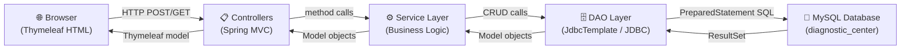

# PAT 4 Demo Guide — Diagnostic Center Management System

## Problem Statement
Design and implement a Diagnostic Center Management System that interfaces a relational MySQL database with a Java web front end using JDBC, demonstrating Create, Read, Update, and Delete (CRUD) operations, JOIN queries, transactions, and data integrity constraints.

---

## Objectives
1. Design a normalized relational MySQL database with multiple tables and foreign-key constraints.
2. Implement database connectivity using **Java JDBC** (specifically Spring's `JdbcTemplate`).
3. Build a full-stack web application using Spring Boot and Thymeleaf.
4. Demonstrate SELECT, INSERT, UPDATE, DELETE, and JOIN SQL operations.
5. Implement secure BCrypt-hashed authentication with Spring Security.
6. Display live database analytics on a Chart.js dashboard.

---

## Software Requirements
| Requirement | Details |
|---|---|
| JDK | 17 or higher |
| Spring Boot | 3.2.5 |
| MySQL | 8.0 |
| MySQL Connector/J | 8.x (JDBC Driver) |
| Build Tool | Apache Maven (Wrapper included) |
| Browser | Chrome, Edge, or Firefox |

## Hardware Requirements
- RAM: Minimum 4 GB (8 GB recommended)
- Storage: 500 MB free
- OS: Windows 10/11, Linux, or macOS

---

## System Architecture

```
Browser (HTML / CSS / JS / Bootstrap 5)
        │  HTTP Requests (Thymeleaf form submissions)
        ▼
Spring MVC Controllers
        │  Business logic calls
        ▼
Service Layer (DiagnosticService)
        │  DAO / Repository method calls
        ▼
DAO Layer (JdbcTemplate — JDBC)
        │  SQL queries (PreparedStatement / parameterized)
        ▼
MySQL Database (diagnostic_center)
```

### Mermaid Diagram


---

## What is JDBC?
**JDBC (Java Database Connectivity)** is the standard Java API that enables Java programs to connect to and execute SQL statements against relational databases. It provides a uniform interface regardless of which database is used.

Key JDBC interfaces:
- `Connection` — represents a live connection to the database.
- `PreparedStatement` — a precompiled SQL statement with `?` placeholders to prevent SQL injection.
- `ResultSet` — the tabular data returned by a SELECT query.

### Why JdbcTemplate?
`JdbcTemplate` is Spring's JDBC abstraction that removes boilerplate code (opening connections, handling exceptions, closing resources). It still uses raw JDBC under the hood and satisfies the academic JDBC requirement.

---

## MySQL JDBC Driver
The `mysql-connector-j` library (`com.mysql:mysql-connector-j`) is the official MySQL JDBC driver maintained by Oracle. It is declared as a Maven dependency and translates Java JDBC calls into the MySQL network protocol.

Class name: `com.mysql.cj.jdbc.Driver`

---

## Database Schema

### Tables and Relationships

| Table | Primary Key | Foreign Keys |
|---|---|---|
| `users` | `user_id` | — |
| `centers` | `center_id` | — |
| `doctors` | `doctor_id` | `center_id → centers` (RESTRICT) |
| `patients` | `patient_id` | — |
| `tests` | `test_id` | — |
| `bookings` | `booking_id` | `patient_id → patients`, `doctor_id → doctors`, `center_id → centers` (all RESTRICT) |
| `booking_tests` | `(booking_id, test_id)` composite | `booking_id → bookings` (CASCADE), `test_id → tests` (RESTRICT) |
| `bills` | `bill_id` | `booking_id → bookings` (RESTRICT) |

### Foreign Key Behavior
- **RESTRICT** — prevents deleting a parent record that has children (data integrity).
- **CASCADE** — `booking_tests` rows are automatically deleted when a booking is deleted.

---

## SQL Operations Used

### SELECT with JOIN
```sql
-- List bookings with patient and center names
SELECT bk.booking_id, p.patient_name, c.center_name, bk.status
FROM bookings bk
JOIN patients p  ON bk.patient_id  = p.patient_id
JOIN centers c   ON bk.center_id   = c.center_id
WHERE bk.status = 'Pending'
ORDER BY bk.booking_date DESC;
```

### SELECT with Aggregate (Dashboard)
```sql
-- Revenue and outstanding amounts
SELECT COALESCE(SUM(amount_paid), 0)                          AS total_revenue,
       COALESCE(SUM(total_amount - discount_amount - amount_paid), 0) AS outstanding
FROM bills;
```

### INSERT with PreparedStatement
```sql
INSERT INTO patients (patient_name, date_of_birth, gender, phone, email, address)
VALUES (?, ?, ?, ?, ?, ?);
```

### UPDATE
```sql
UPDATE bookings SET status = ? WHERE booking_id = ?;
```

### DELETE (safe — FK prevents accidental data loss)
```sql
DELETE FROM patients WHERE patient_id = ?;
-- Will fail with FK violation if patient has linked bookings
```

---

## Prepared Statements and SQL Injection Prevention
All DAO methods use `JdbcTemplate`'s parameterized methods or explicit `PreparedStatement` construction. User-supplied values are **never** concatenated into SQL strings.

**Safe:**
```java
jdbc.update("SELECT * FROM patients WHERE patient_name LIKE ?", "%" + search + "%");
```

**Unsafe (never done in this project):**
```java
// SQL INJECTION RISK — not used in this project
"SELECT * FROM patients WHERE patient_name LIKE '%" + search + "%'";
```

---

## Transactions
Multi-table write operations use `@Transactional` to ensure atomicity. Example: creating a booking simultaneously inserts into `bookings` **and** `booking_tests`. If either insert fails, both are rolled back.

```java
@Transactional
public int save(Booking booking, List<Test> selectedTests) {
    // INSERT into bookings → get generated booking_id
    // INSERT into booking_tests for each test
    // If any INSERT fails → entire transaction rolls back
}
```

---

## Setup and Launch Instructions

### Windows — Step by Step

```powershell
# 1. Verify Java
java -version    # Should show 17 or higher

# 2. Set up MySQL database
mysql -u root -p
# In MySQL:
# CREATE DATABASE diagnostic_center CHARACTER SET utf8mb4;
# CREATE USER 'dcadmin'@'localhost' IDENTIFIED BY 'dcpassword';
# GRANT ALL ON diagnostic_center.* TO 'dcadmin'@'localhost';
# FLUSH PRIVILEGES; EXIT;

# 3. Import schema and demo data
mysql -u dcadmin -pdcpassword diagnostic_center < database\schema.sql
mysql -u dcadmin -pdcpassword diagnostic_center < database\seed.sql

# 4. Set environment variables
$env:DB_URL      = "jdbc:mysql://localhost:3306/diagnostic_center?useSSL=false&serverTimezone=UTC&allowPublicKeyRetrieval=true"
$env:DB_USERNAME = "dcadmin"
$env:DB_PASSWORD = "dcpassword"

# 5. Run the application
.\mvnw spring-boot:run

# 6. Open browser and log in
Start-Process "http://localhost:8080"
# Username: admin  Password: Admin@1234
```

---

## Test Cases and Expected Results

| # | Action | Expected Result |
|---|---|---|
| 1 | Load login page | Login form visible with demo credentials hint |
| 2 | Login with admin/Admin@1234 | Redirect to Dashboard with live stats |
| 3 | Login with wrong password | Error message shown |
| 4 | Access /dashboard without login | Redirected to /login |
| 5 | Add new patient | Appears in patients list, ID auto-incremented |
| 6 | Edit patient record | Changes saved and reflected immediately |
| 7 | Try to delete patient with bookings | FK constraint error shown, patient not deleted |
| 8 | Add doctor assigned to center | Doctor appears with center name in list |
| 9 | Create booking with 3 tests | Total calculated server-side from DB test prices |
| 10 | Generate bill for booking | Bill created with server-side total (not client) |
| 11 | Record partial payment | Status changes to "Partial", outstanding updated |
| 12 | Record remaining payment | Status changes to "Paid" |
| 13 | Submit empty required field | Validation error message shown inline |
| 14 | Add test with negative price | Validation error: price ≥ 0 |
| 15 | Open Reports with date range | Charts update based on filtered SQL query results |
| 16 | Delete center with doctors | FK error: "records depend on this data" message |
| 17 | Update booking status to Completed | Booking detail shows "Completed" badge |

---

## Demonstration Sequence for Lab Evaluation

1. **Start the app** — show the running server in terminal.
2. **Login page** — explain Spring Security, BCrypt hashing.
3. **Dashboard** — explain live aggregate SQL queries, Chart.js integration.
4. **Add a Patient** — demonstrate INSERT using JdbcTemplate.
5. **List Patients** — demonstrate SELECT with search (LIKE query).
6. **Edit Patient** — demonstrate UPDATE.
7. **Add Doctor** — show FK relationship to centers.
8. **Create Booking** — multi-test selection, show server-side total.
9. **Generate Bill** — explain server-side total calculation from DB.
10. **Record Payment** — show payment validation (cannot exceed outstanding).
11. **Reports** — show date-filtered aggregate SQL results in charts.
12. **Try deleting a patient with bookings** — demonstrate FK RESTRICT constraint.
13. **Show source code** — highlight JdbcTemplate DAO, PreparedStatement, @Transactional.

---

## Viva Questions and Answers

### 1. What is JDBC? Why is it used?
**Answer:** JDBC (Java Database Connectivity) is a Java API that provides a standard interface for connecting to relational databases. It is used because it allows Java applications to execute SQL statements, retrieve results, and manage transactions in a database-agnostic way.

### 2. What is JdbcTemplate?
**Answer:** `JdbcTemplate` is a Spring class that wraps JDBC and removes boilerplate code such as opening connections, handling `SQLException`, and closing resources. It still uses real JDBC under the hood.

### 3. What is a PreparedStatement and why use it?
**Answer:** A `PreparedStatement` is a precompiled SQL statement that uses `?` placeholders for parameters. Parameters are set separately, which prevents SQL injection attacks because user input is never concatenated into the SQL string.

### 4. What is SQL injection?
**Answer:** SQL injection is a security attack where malicious SQL code is inserted into user input fields and executed by the database. For example, entering `'; DROP TABLE patients; --` as a name could delete data. PreparedStatements prevent this by treating inputs as literal values, not SQL code.

### 5. What is a Foreign Key?
**Answer:** A foreign key is a column in one table that references the primary key of another table, enforcing referential integrity. For example, `doctor_id` in `bookings` references `doctor_id` in `doctors`, ensuring a booking cannot reference a non-existent doctor.

### 6. What does RESTRICT mean on a FK?
**Answer:** `ON DELETE RESTRICT` means the database will reject a DELETE operation on the parent row if child rows reference it. For example, you cannot delete a patient who has existing bookings.

### 7. What is a transaction in JDBC?
**Answer:** A transaction groups multiple SQL statements into a single atomic unit. Either all statements succeed and are committed, or any failure causes all to be rolled back, ensuring data consistency.

### 8. What is BCrypt?
**Answer:** BCrypt is a password hashing algorithm that applies a salt and multiple rounds of hashing, making brute-force attacks computationally expensive. Spring Security's `BCryptPasswordEncoder` is used to hash passwords before storing them.

### 9. What is Spring Security?
**Answer:** Spring Security is a framework that handles authentication and authorization in Spring applications. In this project it manages the login form, BCrypt password verification, session management, CSRF protection, and route protection.

### 10. What is CSRF and how is it prevented?
**Answer:** CSRF (Cross-Site Request Forgery) tricks a user's browser into making unauthorized requests. Spring Security generates a unique CSRF token for each session; this token must be included in every form submission. Thymeleaf automatically adds it.

### 11. Explain the project layers.
**Answer:** The application uses four layers: (1) **Controller** — receives HTTP requests and returns views; (2) **Service** — contains business logic; (3) **DAO** — executes JDBC queries; (4) **Model** — represents data objects. Thymeleaf templates act as the view layer.

### 12. What is the difference between JOIN types used?
**Answer:** In this project, `INNER JOIN` is used when both sides must exist (e.g., a booking must have a patient). `LEFT JOIN` is used for optional relationships (e.g., a doctor may or may not be assigned to a center).

### 13. What is a composite primary key?
**Answer:** A composite primary key uses two or more columns together to uniquely identify a row. In `booking_tests`, the composite key is `(booking_id, test_id)` because the same test cannot appear twice in the same booking.

### 14. How are dashboard statistics calculated?
**Answer:** All statistics use SQL aggregate functions: `COUNT(*)` for totals, `SUM()` for revenue, `WHERE status = ?` for filtered counts. Results come from querying MySQL directly — no hardcoded values are used.

### 15. How is the billing total calculated securely?
**Answer:** When a bill is generated, the server queries the `booking_tests` table and sums the `agreed_price` column for that booking. The total is never taken from the browser (which could be manipulated). This ensures billing integrity.

---

*Generated for DBMS Lab PAT 4 — Diagnostic Center Management System*
